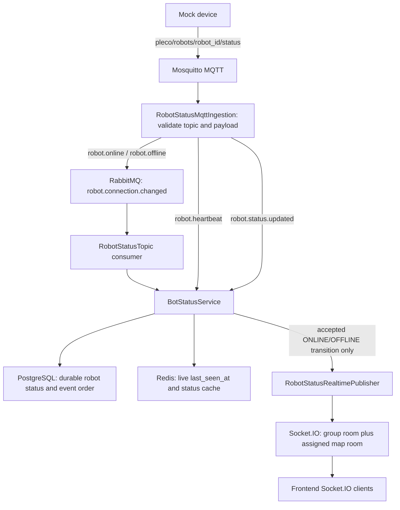

# Robot Status: Mock Device to Frontend

This guide describes the current backend path for robot connectivity, heartbeat,
and operational-status messages. The frontend receives connectivity changes
through Socket.IO at `/api/v1/ws` on the default namespace `/`. This is a
Socket.IO connection, not a raw WebSocket event endpoint.

## End-to-end flow



The mock device sends status messages on `pleco/robots/{robot_id}/status`.
`robot.offline` may arrive from a graceful shutdown or the MQTT Last Will after
the broker detects a lost connection. MQTT ingestion validates the JSON payload
and requires the payload's robot ID to match the topic ID before routing it.

| Device event | Backend route | Durable/live effect | Frontend event |
| --- | --- | --- | --- |
| `robot.online` | MQTT → RabbitMQ connectivity consumer → status service | On an accepted transition, persist `ONLINE` and initialize Redis freshness | `robot.status` |
| `robot.offline` | MQTT → RabbitMQ connectivity consumer → status service | On an accepted transition, persist `OFFLINE`, snapshot the latest Redis heartbeat if available, and clear live freshness | `robot.status` |
| `robot.heartbeat` | MQTT → status service directly | Refresh Redis `last_seen_at` for a registered online robot; no PostgreSQL write | None |
| `robot.status.updated` | MQTT → status service directly | Persist accepted operational changes and ordering; update the Redis status cache | None |

RabbitMQ uses the `pleco.robot.events` topic exchange, the
`robot.connection.changed` routing key, and the `pleaco-backend.robot-status`
queue. Its consumer acknowledges a message after the status service returns.
Malformed RabbitMQ JSON is rejected; handler failures are requeued by default.
Heartbeats and operational updates do not enter this connectivity queue.

## Status processing and delivery

For a connectivity event, `BotStatusService` locks the robot row, rejects an
unknown robot or a duplicate or stale sequence, and commits the accepted state
to PostgreSQL. The robot's `group_id` and assigned `map_id` come from that
persisted row, not the device payload. It then updates the Redis status cache
with a sequence fence and checks the database sequence again before publishing.

Only an actual `OFFLINE → ONLINE` or `ONLINE → OFFLINE` transition emits
`robot.status`. A newer event that leaves connectivity unchanged still advances
the saved sequence but emits nothing. IP-only and operational-only changes also
emit nothing. A heartbeat never emits a Socket.IO event.

The publisher sends one event to the union of `group:{group_id}` and, when the
robot has an assigned map, `map:{map_id}`. A socket in both rooms receives one
copy. An unassigned robot targets only its group room. Socket.IO delivery is
best-effort: a delivery failure is logged and does not undo the committed
database change or cause RabbitMQ to retry an already-applied transition.

## Frontend contract

The event name is `robot.status`. Its JSON payload uses the existing
`RobotStatusRealtimePayload` fields:

```json
{
  "robot_id": "00000000-0000-0000-0000-000000000001",
  "ip_address": "192.168.10.24",
  "connection_status": "ONLINE",
  "operational_status": "IDLE",
  "last_seen_at": "2026-10-19T10:00:00Z"
}
```

`ip_address` and `last_seen_at` can be `null`. The example timestamp illustrates
the wire format; the backend supplies its receive time for an ONLINE transition.
For an OFFLINE transition, `last_seen_at` is the latest available heartbeat
timestamp or the existing PostgreSQL snapshot when Redis freshness is missing.

The frontend authenticates its Socket.IO connection with the existing cookie.
On connection, the backend joins the socket to `user:{user_id}` and, when an
active group is present and membership is valid, `group:{group_id}`. To join a
map room, the client sends `map.subscribe` with `{"mapId": "<map UUID>"}`;
`MapRoomService` authorizes that subscription against the active group before
joining `map:{map_id}`. `map.unsubscribe` removes only the map membership.

For the detailed room authorization flow, see
[Socket.IO Map Rooms: Data Flow](SOCKETIO_MAP_ROOMS_DATA_FLOW.md).

For the proposed startup and periodic heartbeat timeout handling, see
[Robot Heartbeat Timeout Reconciliation](ROBOT_HEARTBEAT_STALE_RECONCILIATION.md).
